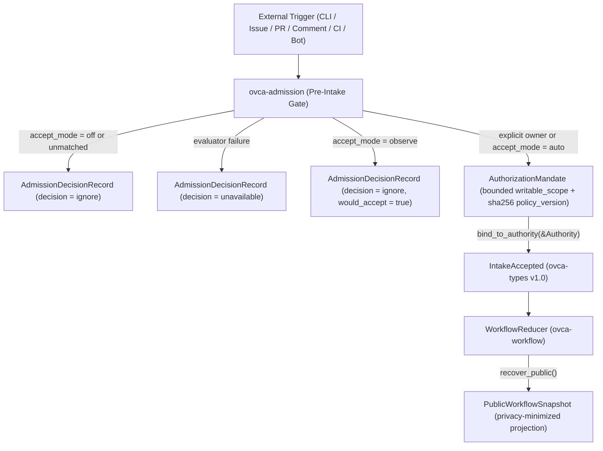
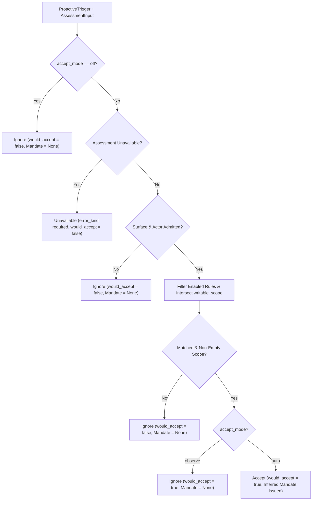
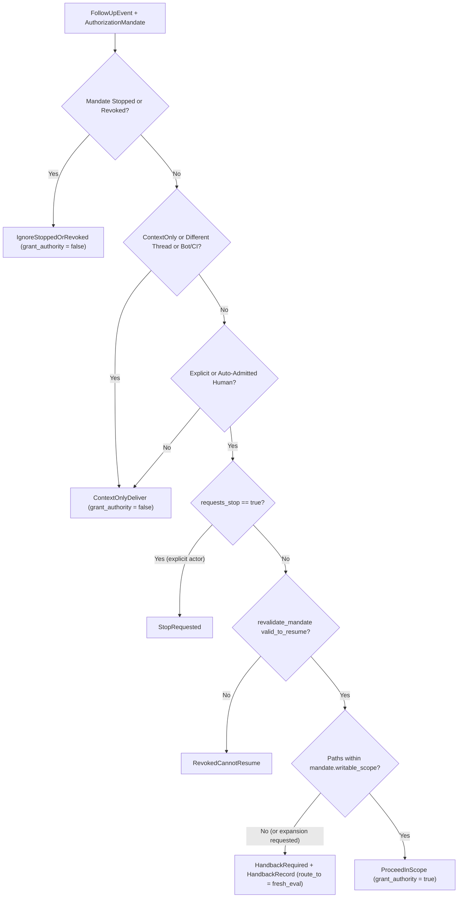
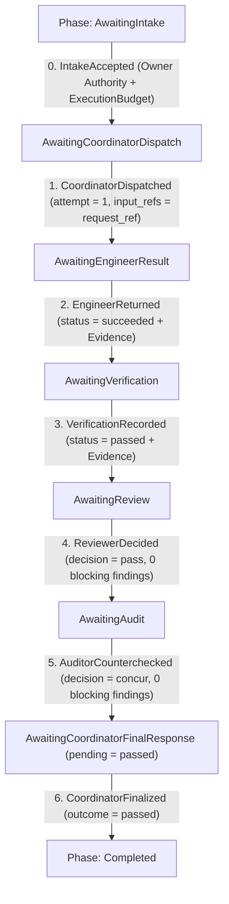
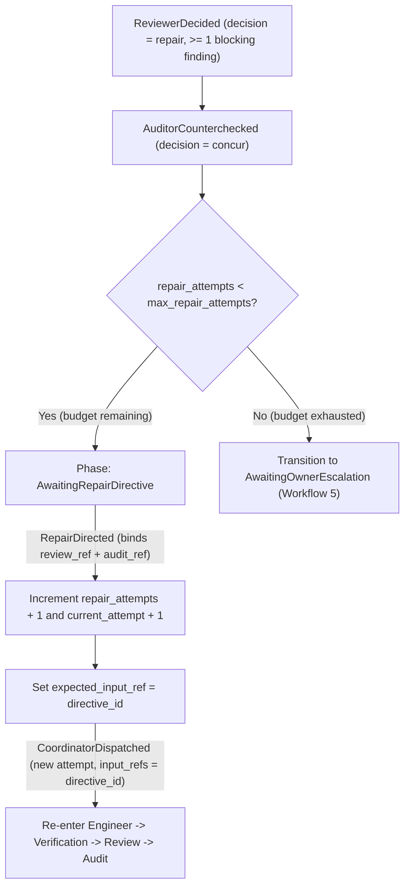
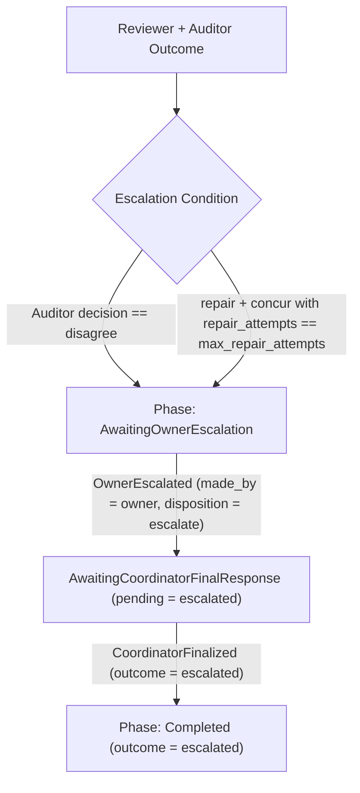
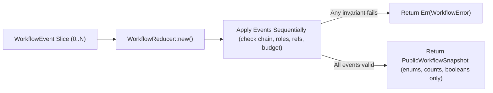
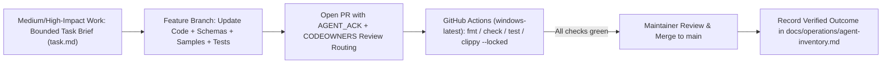

# OVCA Reference (`v0.2`)

**English** | **[ภาษาไทย (README.th.md)](README.th.md)**

OVCA is a public, domain-neutral Rust and JSON Schema reference for **evidence-bound multi-role workflows** and **pre-intake admission governance**.

It separates **who may initiate or expand work** (`ovca-admission`) from **how accepted work is executed, verified, reviewed, counterchecked, and finalized** (`ovca-types` and `ovca-workflow`)—without coupling the reference model to any specific LLM provider, network service, or storage backend.

---

## 1. Purpose & System Boundary

Automated coding and research harnesses commonly fail at two boundaries:

1. **Pre-Intake Boundary (`Context != Authority`):** Subscribed thread comments, bot notifications, CI webhooks, or follow-up requests that widen file scope are treated as implicit permission to mutate a repository, or uncalibrated proactive rules are enabled without an observation phase.
2. **Post-Intake Boundary (`Execution != Judgment`):** A single agent writes changes, claims tests passed, and approves its own work without independent review, audit countercheck, bounded repair budgets, or verifiable evidence lineage.

OVCA models both boundaries as **pure, synchronous, deterministic Rust state transitions** backed by closed Draft 2020-12 JSON Schemas. None of the workspace crates receives filesystem, network, clock, credential, persistence, or role-execution capabilities; callers supply events, policies, timestamps, and identifiers.

---

## 2. End-to-End Architecture & Component Map

### Five Workflow Roles (`ovca-types::Role`)

| Role | Responsibility | Mutation / Decision Boundary |
|---|---|---|
| **Owner** | Grants `Authority` (`objective`, `scope`, `constraints`), sets `ExecutionBudget`, and resolves escalations | Originates workflow authority; issues `OwnerEscalated` decisions |
| **Coordinator** | Accepts intake, dispatches `Engineer` attempts, and emits `FinalResponse` | Orchestrates transitions; never fabricates evidence |
| **Engineer** | Produces `RoleResult` (`succeeded` or `failed`) and attaches `Evidence` | Cannot review, approve, or finalize its own result |
| **Reviewer** | Evaluates current `RoleResult` + `VerificationOutcome` and records `pass` or `repair` | Cannot pass a failed build/verification; cannot mutate work directly |
| **Auditor** | Independently counterchecks `ReviewPacket` (`concur` or `disagree`) | Disagreement forces `OwnerEscalated`; never mutates work directly |

### Repository Contents

| Path | Responsibility |
|---|---|
| `rust/ovca-types` | Version `1.0` contracts (`Authority`, `Evidence`, `RoleInvocation`, `RoleResult`, `VerificationOutcome`, `ReviewPacket`, `AuditPacket`, `RepairDirective`, `ExecutionBudget`, `FinalResponse`, `WorkflowEvent`) and `Validate` rules |
| `rust/ovca-workflow` | Transactional `WorkflowReducer`, `WorkflowPhase` state machine, and privacy-minimized `recover_public` helper |
| `rust/ovca-admission` | Pre-intake `AdmissionPolicy`, pure-Rust FIPS 180-4 SHA-256 `policy_version`, `AuthorizationMandate`, `revalidate_mandate`, `evaluate_followup` (`HandbackRecord`), and `evaluate_proactive_admission` (`off \| observe \| auto`) |
| `contracts/` | Closed Draft 2020-12 JSON Schemas (`*.v1.schema.json`) and synthetic samples (`contracts/samples/*.v1.sample.json`) |
| `examples/` | Complete synthetic `WorkflowEvent` streams ([pass.json](examples/pass.json), [repair_then_pass.json](examples/repair_then_pass.json), [disagreement_escalation.json](examples/disagreement_escalation.json)) |
| `docs/` | [Architecture](docs/architecture.md), [System workflows](docs/system-workflows.md), [Security boundary](docs/security-boundary.md), [Limitations](docs/limitations.md), [Agent inventory](docs/operations/agent-inventory.md), and ADRs (`docs/adr/`) |
| `skills/zoom-out` | Installable instruction-only Codex skill ([SKILL.md](skills/zoom-out/SKILL.md)) for evidence-grounded system mapping |
| `.github/` | `--locked` Rust CI workflow, `CODEOWNERS`, optional `Bounded Task Brief` issue template, and pull-request `AGENT_ACK` template |

---

## 3. Detailed Workflow Guide (7 Workflows)

### Workflow 1: Proactive Admission & Observe-Mode Calibration (`ovca-admission`)

- **Purpose:** Calibrate proactive automation rules safely without mutating the repository, while keeping evaluator outages (`unavailable`) strictly distinct from benign `ignore` outcomes.
- **Entrypoint:** `evaluate_proactive_admission` in `rust/ovca-admission/src/lib.rs`
- **Modes (`AcceptMode`):**
  - `off` -> Immediately returns `decision = "ignore"` (`would_accept = false`, `Mandate = None`).
  - `observe` -> Evaluates enabled `ProactiveRule` entries, computes conservative `writable_scope` intersection (`intersect_rule_scopes`), and records `would_accept = true` **without issuing an `AuthorizationMandate`**.
  - `auto` -> Returns `decision = "accept"`, `would_accept = true`, and issues a bounded `inferred` `AuthorizationMandate` pinned to `canonical_policy_version()` (`sha256:<64 hex>`).

---

### Workflow 2: Mandate Binding, Revalidation & Follow-Up Handback (`Context != Authority`)

- **Purpose:** Keep `AuthorizationMandate` immutable so thread noise, bot comments, CI notifications, or out-of-scope follow-ups can never silently widen write permissions.
- **Entrypoints:** `AuthorizationMandate::bind_to_authority`, `revalidate_mandate`, and `evaluate_followup` in `rust/ovca-admission/src/lib.rs`
- **Core Invariants:**
  - **Scope Containment:** `is_path_within_scope` checks repository-relative path segments so `rust/ovca-types` never admits `rust/ovca-types-extra` or `..` traversal.
  - **No Bot Explicit Authority:** Bot logins (`*[bot]`) and default-branch CI triggers cannot hold `explicit` mandates, stop an owner mandate, or wake an `ended` mandate.
  - **Policy Revalidation:** `inferred` mandates are automatically `revoked` if `accept_mode` leaves `auto`, a matched rule is disabled, or its `writable_scope` narrows.
  - **Structured Handback:** Human follow-ups requesting paths outside `mandate.writable_scope` emit `FollowUpAction::HandbackRequired` with a `HandbackRecord` (`route_to = "fresh_eval"`).

---

### Workflow 3: Post-Intake Pass & Finalization (`examples/pass.json`)

- **Purpose:** Enforce the six-step evidence spine before any work reaches a `passed` public outcome.
- **Entrypoint & Fixture:** `WorkflowReducer::apply` in `rust/ovca-workflow/src/lib.rs` and [examples/pass.json](examples/pass.json) (7 events).
- **Guardrails:** Every `apply` call is transactional (validates against a cloned reducer state). `ReviewerDecided(pass)` is rejected if `EngineerReturned` failed (`PassedFailedEngineerResult`), if `VerificationRecorded` failed (`PassedFailedVerification`), or if any blocking finding is present.

---

### Workflow 4: Post-Intake Bounded Repair Loop (`examples/repair_then_pass.json`)

- **Purpose:** Route defects back through `Coordinator` and `Engineer` under a strict `max_repair_attempts` cap rather than allowing reviewers or auditors to mutate work directly.
- **Entrypoint & Fixture:** `WorkflowEventKind::RepairDirected` in `rust/ovca-workflow/src/lib.rs` and [examples/repair_then_pass.json](examples/repair_then_pass.json) (13 events).
- **Input Continuity Rule:** Accepting `RepairDirected` increments `repair_attempts` and `current_attempt`, and replaces the required dispatch input reference with `directive_id`. Re-dispatching with the stale initial `request_ref` fails with `InputReferenceMismatch`.

---

### Workflow 5: Post-Intake Owner Escalation (`examples/disagreement_escalation.json`)

- **Purpose:** Return control to the `Owner` whenever independent judgment diverges or bounded repair capacity is exhausted.
- **Triggers:**
  1. `AuditorCounterchecked(disagree)` (regardless of whether the Reviewer chose `pass` or `repair`).
  2. `ReviewerDecided(repair)` + `AuditorCounterchecked(concur)` when `repair_attempts == max_repair_attempts`.
- **Budget Reservation:** `ExecutionBudget::validate` enforces `max_events >= 8 + (6 * max_repair_attempts)` at intake so every declared repair attempt always leaves room for `OwnerEscalated` and `CoordinatorFinalized(escalated)`. See [examples/disagreement_escalation.json](examples/disagreement_escalation.json).

---

### Workflow 6: Public Recovery & Privacy Projection (`recover_public`)

- **Purpose:** Replay an event log deterministically and expose a minimized status summary safe from accidental disclosure of caller-supplied text or identifiers.
- **Entrypoint:** `recover_public(events)` in `rust/ovca-workflow/src/lib.rs`
- **Projection Boundary:** Returns `PublicWorkflowSnapshot` containing only `phase`, `event_count`, `repair_attempts`, `outcome`, `evidence_count` (globally unique `Evidence` IDs introduced by `EngineerReturned` and `VerificationRecorded`), and `final_response_present`. Caller strings, IDs, and `FinalResponse` are omitted.

---

### Workflow 7: GitHub Operational & CI Verification Workflow

- **Purpose:** Align day-to-day repository pull requests with OVCA's evidence and scope discipline (`Minimum Sufficient Collaboration` and `No Implicit Pass`).
- **Artifacts:** [.github/ISSUE_TEMPLATE/task.md](.github/ISSUE_TEMPLATE/task.md), [.github/pull_request_template.md](.github/pull_request_template.md), [.github/CODEOWNERS](.github/CODEOWNERS), [.github/workflows/ci.yml](.github/workflows/ci.yml), and [docs/operations/agent-inventory.md](docs/operations/agent-inventory.md).

---

## 4. Codex Skill (`zoom-out`)

The repository includes the instruction-only [Zoom Out skill](skills/zoom-out/SKILL.md). It adds no executable, service, or external connection to this repository.

Install it by copying `skills/zoom-out` into the `skills` directory under `CODEX_HOME` (normally `~/.codex/skills`):

~~~text
# macOS or Linux
codex_home="${CODEX_HOME:-$HOME/.codex}"
skills_dir="$codex_home/skills"
skill_dest="$skills_dir/zoom-out"
if [ -e "$skill_dest" ] || [ -L "$skill_dest" ]; then
  printf 'Refusing to overwrite existing path: %s\n' "$skill_dest" >&2
else
  mkdir -p "$skills_dir"
  cp -R skills/zoom-out "$skill_dest"
fi

# PowerShell
$codexHome = if ($env:CODEX_HOME) { $env:CODEX_HOME } else { Join-Path $HOME '.codex' }
$skillsDir = Join-Path $codexHome 'skills'
$skillDest = Join-Path $skillsDir 'zoom-out'
if ($null -ne (Get-Item -LiteralPath $skillDest -Force -ErrorAction SilentlyContinue)) {
  throw "Refusing to overwrite existing path: $skillDest"
}
New-Item -ItemType Directory -Force -Path $skillsDir | Out-Null
Copy-Item -LiteralPath 'skills\zoom-out' -Destination $skillDest -Recurse -ErrorAction Stop
~~~

Invoke it explicitly with a request such as:

~~~text
Use $zoom-out to map this repository in English and return the overview in chat.
~~~

---

## 5. Validation

From the repository root:

~~~text
cargo fmt --manifest-path rust/Cargo.toml --all -- --check
cargo check --manifest-path rust/Cargo.toml --all-targets --locked
cargo test --manifest-path rust/Cargo.toml --all-targets --locked
cargo clippy --manifest-path rust/Cargo.toml --all-targets --locked -- -D warnings
~~~

The contract tests parse every JSON Schema file as JSON, deserialize each synthetic sample into its Rust type (enforcing `#[serde(deny_unknown_fields)]` and required collection fields), and run semantic validation via `Validate`. They do not evaluate samples with an external JSON Schema engine.

## 6. Scope & License

This repository demonstrates pre-intake admission evaluation, contract compatibility, and deterministic workflow reduction. It does not authenticate transport-level identities, inspect evidence payloads, run verification commands, execute role work, or persist event logs. See [Security boundary](docs/security-boundary.md) and [Limitations](docs/limitations.md).

Licensed under Apache-2.0. See [THIRD_PARTY_LICENSES.md](THIRD_PARTY_LICENSES.md) for dependency notices.
