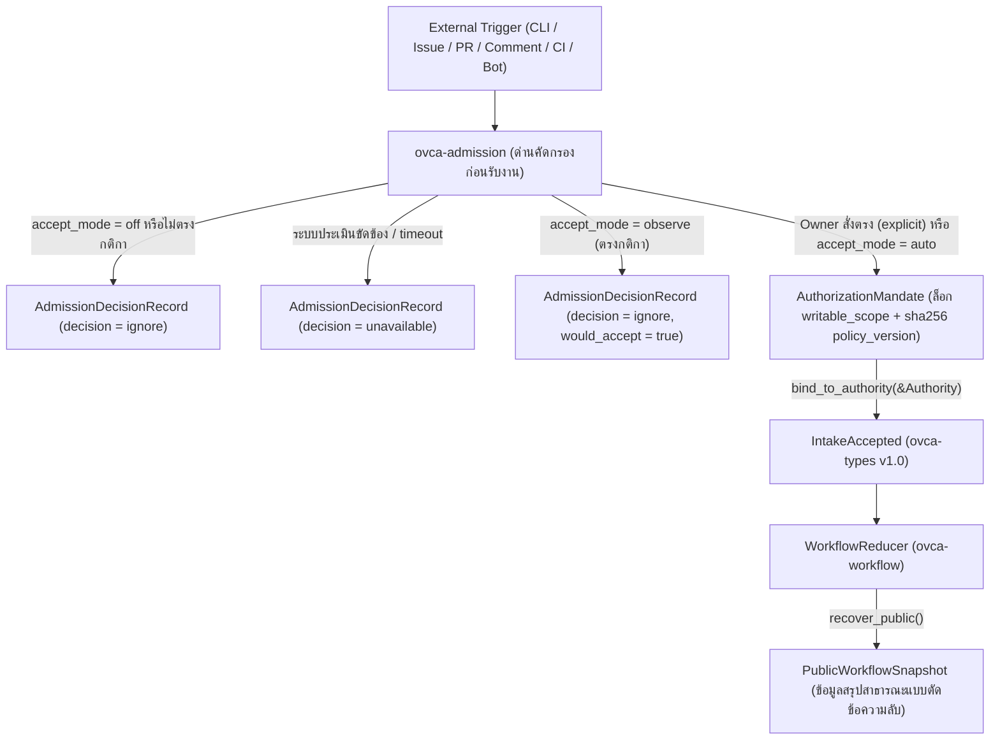
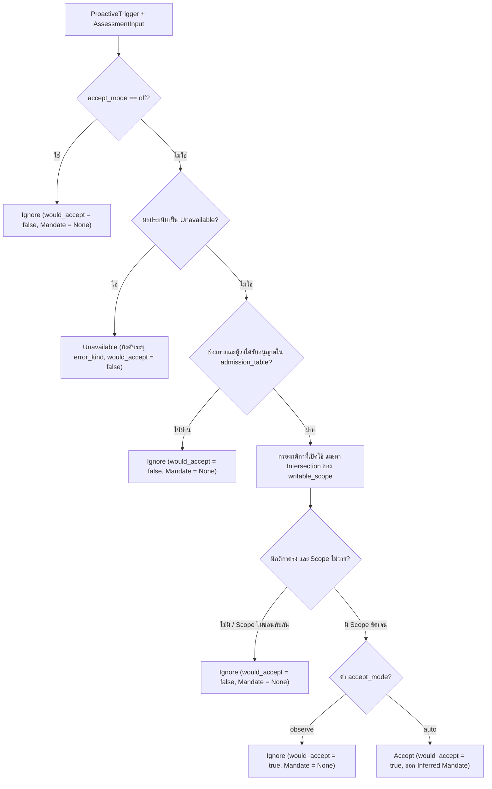
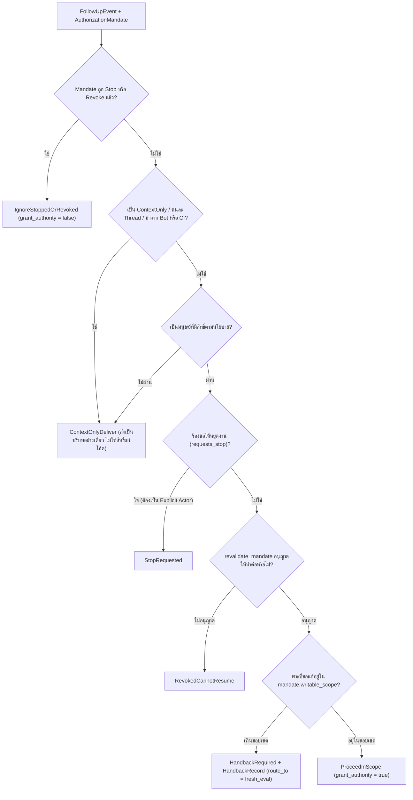
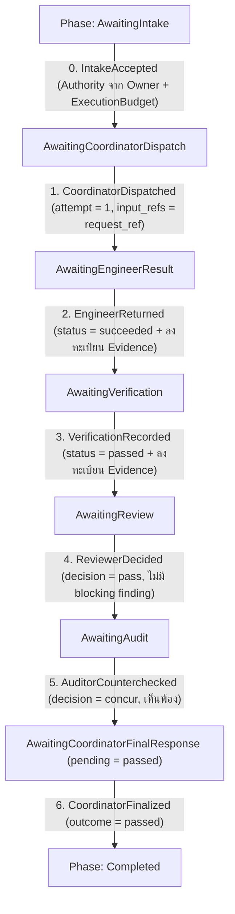
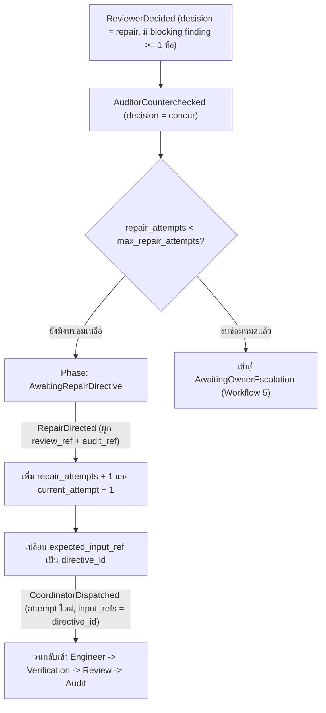
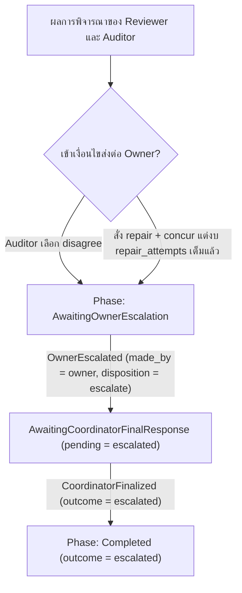
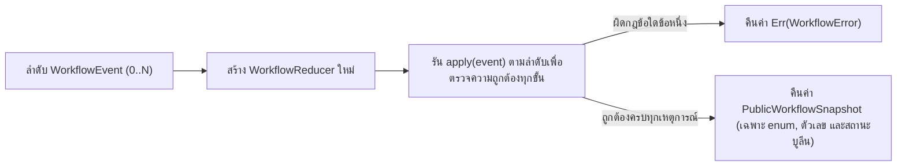
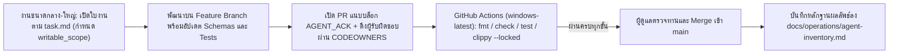

# OVCA Reference (`v0.2`) — คู่มือสถาปัตยกรรมและ Workflow ฉบับภาษาไทย

**[English (README.md)](README.md)** | **ภาษาไทย**

OVCA คือชุดไลบรารีอ้างอิงสาธารณะแบบไม่ผูกติดโดเมน (Domain-Neutral Public Reference) พัฒนาด้วยภาษา Rust และ JSON Schema สำหรับ **กระบวนการทำงานหลายบทบาทที่ขับเคลื่อนด้วยหลักฐานจริง (Evidence-Bound Multi-Role Workflows)** และ **การคัดกรองสิทธิ์ก่อนรับงาน (Pre-Intake Admission Governance)**

ระบบออกแบบให้แยกความรับผิดชอบออกเป็น 2 ชั้นอย่างชัดเจน:
1. **ชั้นคัดกรองสิทธิ์ก่อนรับงาน (`ovca-admission`):** คุมว่า *"ใครหรือเหตุการณ์ใดมีสิทธิ์สั่งเริ่มงานหรือขยายขอบเขตไฟล์"* (`Context != Authority`) พร้อมระบบทดลองวัดผลกติกาอัตโนมัติ (`Observe Mode`)
2. **ชั้นลดรูปสถานะและตรวจสอบงาน (`ovca-types` และ `ovca-workflow`):** คุมว่า *"งานที่ถูกรับเข้ามาแล้วต้องผ่านการลงมือทำ ตรวจผล รีวิวอิสระ ตรวจสอบถ่วงดุล (Audit) และปิดงานอย่างไร"* โดยไม่ผูกกับผู้ให้บริการโมเดล AI เครือข่าย หรือฐานข้อมูลใดเป็นพิเศษ

---

## 1. เป้าหมายและขอบเขตของระบบ (Purpose & System Boundary)

ระบบอัตโนมัติและ AI Agent มักเกิดความผิดพลาดซ้ำซากใน 2 จุด:

1. **ความสับสนระหว่างบริบทกับอำนาจสั่งการ (`Context != Authority`):** การได้รับแจ้งเตือนจากกระทู้ที่ติดตามไว้ คอมเมนต์จากบอท สัญญาณจาก CI หรือข้อความคุยต่อที่ขอให้แก้ไฟล์นอกขอบเขต มักถูกตีความผิดว่าเป็นคำสั่งอนุมัติให้แก้ไขโค้ดทันที หรือมีการเปิดกติกาอัตโนมัติโดยไม่มีระยะสังเกตการณ์ (`Observe`)
2. **ผู้ลงมือทำเป็นผู้ตรวจผ่านงานตัวเอง (`Execution != Judgment`):** เอเจนต์ตัวเดียวเป็นทั้งผู้เขียนโค้ด อ้างว่าทดสอบผ่าน และอนุมัติงานตัวเอง โดยขาดผู้รีวิวอิสระ ผู้ตรวจสอบถ่วงดุล (Auditor) เพดานการซ่อมงานที่ชัดเจน และสายโซ่หลักฐานที่ตรวจสอบย้อนหลังได้

OVCA แก้ปัญหาทั้งสองจุดด้วย **State Machine แบบ Deterministic ในภาษา Rust** คู่กับ **JSON Schema (Draft 2020-12)** ที่ปฏิเสธฟิลด์แปลกปลอมทุกชนิด โดยทั้ง 3 crates ไม่มีโค้ดอ่านเขียนไฟล์ ต่อเครือข่าย อ่านนาฬิกาเครื่อง หรือรันคำสั่งภายนอกเอง ผู้เรียกใช้งานเป็นผู้ส่งข้อมูลและเหตุการณ์เข้ามาให้ไลบรารีตรวจสอบทั้งหมด

---

## 2. แผนผังสถาปัตยกรรมและส่วนประกอบ (End-to-End Architecture & Component Map)

### บทบาทหลักทั้ง 5 ในระบบ (`ovca-types::Role`)

| บทบาท (Role) | หน้าที่ความรับผิดชอบ | ขอบเขตอำนาจและข้อจำกัด |
|---|---|---|
| **Owner** | กำหนด `Authority` (`objective`, `scope`, `constraints`), ตั้งงบ `ExecutionBudget` และชี้ขาดกรณี Escalate | เป็นผู้ให้กำเนิดสิทธิ์สูงสุดของ Workflow และออกคำตัดสิน `OwnerEscalated` |
| **Coordinator** | รับงานเข้า (`IntakeAccepted`), จ่ายงานให้ `Engineer` และออกสรุปปิดงาน (`FinalResponse`) | ควบคุมจังหวะการส่งต่องาน ห้ามสร้างหลักฐานการทดสอบขึ้นเอง |
| **Engineer** | ลงมือทำงานและส่งผลลัพธ์ `RoleResult` (`succeeded` หรือ `failed`) พร้อมแนบ `Evidence` | ห้ามรีวิว ห้ามอนุมัติ และห้ามปิดงานของตนเอง |
| **Reviewer** | ตรวจ `RoleResult` คู่กับ `VerificationOutcome` แล้วตัดสิน `pass` หรือ `repair` | ห้ามให้ `pass` หากผลทำหรือผลตรวจล้มเหลว และห้ามแก้ไขชิ้นงานโดยตรง |
| **Auditor** | ตรวจสอบถ่วงดุลผลของ Reviewer อีกชั้นอย่างเป็นอิสระ (`concur` หรือ `disagree`) | หากกด `disagree` ระบบบังคับส่งขึ้น `OwnerEscalated` ทันที และห้ามแก้ชิ้นงานโดยตรง |

### โครงสร้างไฟล์ใน Repository

| พาธ | หน้าที่ |
|---|---|
| `rust/ovca-types` | โครงสร้างสัญญา `v1.0` (`Authority`, `Evidence`, `RoleInvocation`, `RoleResult`, `VerificationOutcome`, `ReviewPacket`, `AuditPacket`, `RepairDirective`, `ExecutionBudget`, `FinalResponse`, `WorkflowEvent`) และกฎ `Validate` |
| `rust/ovca-workflow` | ตัวลดรูปสถานะ `WorkflowReducer` แบบ transactional และฟังก์ชันกู้คืนสถานะสาธารณะ `recover_public` |
| `rust/ovca-admission` | นโยบายคัดกรอง `AdmissionPolicy`, การคำนวณ `policy_version` ด้วย SHA-256 (FIPS 180-4), `AuthorizationMandate`, `revalidate_mandate`, `evaluate_followup` (`HandbackRecord`) และ `evaluate_proactive_admission` (`off \| observe \| auto`) |
| `contracts/` | เอกสาร Draft 2020-12 JSON Schemas (`*.v1.schema.json`) และข้อมูลตัวอย่าง (`contracts/samples/*.v1.sample.json`) |
| `examples/` | ตัวอย่างสายโซ่เหตุการณ์ครบวงจร 3 สถานการณ์ ([pass.json](examples/pass.json), [repair_then_pass.json](examples/repair_then_pass.json), [disagreement_escalation.json](examples/disagreement_escalation.json)) |
| `docs/` | [Architecture](docs/architecture.md), [System workflows](docs/system-workflows.md), [Security boundary](docs/security-boundary.md), [Limitations](docs/limitations.md), [Agent inventory](docs/operations/agent-inventory.md) และบันทึกการตัดสินใจสถาปัตยกรรม (`docs/adr/`) |
| `skills/zoom-out` | ทักษะ Codex แบบคำสั่งล้วน ([SKILL.md](skills/zoom-out/SKILL.md)) สำหรับสำรวจและสรุปแผนที่ระบบจากหลักฐานจริง |
| `.github/` | เวิร์กโฟลว์ CI แบบ `--locked`, `CODEOWNERS`, แม่แบบใบงาน `Bounded Task Brief` และแม่แบบ PR พร้อมบล็อก `AGENT_ACK` |

---

## 3. อธิบายเจาะลึกทั้ง 7 Workflows พร้อม Flowchart

### Workflow 1: การคัดกรองงานอัตโนมัติและโหมดสังเกตการณ์ (`Proactive Admission & Observe Mode`)

- **วัตถุประสงค์:** ใช้ทดสอบและวัดความแม่นยำของกติกาอัตโนมัติ (`ProactiveRule`) โดยไม่เข้าไปแก้ไขโค้ดจริงในระหว่างปรับจูน และแยกแยะกรณีระบบประเมินล่ม (`unavailable`) ออกจากกรณีไม่เข้าเกณฑ์ปกติ (`ignore`) อย่างเด็ดขาด
- **จุดเข้าใช้งาน:** `evaluate_proactive_admission` ใน `rust/ovca-admission/src/lib.rs`
- **พฤติกรรมตามโหมด `AcceptMode`:**
  - `off` -> ปฏิเสธทันที (`decision = "ignore"`, `would_accept = false`, ไม่ออก Mandate)
  - `observe` -> ประเมินกติกาที่เปิดใช้งาน หาขอบเขตไฟล์ส่วนที่ซ้อนทับกัน (`intersect_rule_scopes`) แล้วบันทึก `would_accept = true` ลงผลลัพธ์ **แต่ไม่ออก `AuthorizationMandate`**
  - `auto` -> คืนค่า `decision = "accept"`, `would_accept = true` และออกใบอนุญาต `AuthorizationMandate` แบบ `inferred` ที่ผูกกับค่าแฮช `canonical_policy_version()` (`sha256:<64 hex>`)

---

### Workflow 2: การผูกสิทธิ์ การตรวจซ้ำ และการส่งกลับเมื่อเกินขอบเขต (`Context != Authority`)

- **วัตถุประสงค์:** ล็อกให้ `AuthorizationMandate` เปลี่ยนแปลงไม่ได้กลางคัน (Immutable) เพื่อไม่ให้ข้อความแทรกในกระทู้ บอท หรือผลรัน CI แอบขยายสิทธิ์เขียนไฟล์โดยไม่ผ่านการประเมินใหม่
- **จุดเข้าใช้งาน:** `AuthorizationMandate::bind_to_authority`, `revalidate_mandate` และ `evaluate_followup` ใน `rust/ovca-admission/src/lib.rs`
- **กฎความปลอดภัยหลัก:**
  - **การตรวจพาธแบบแยก Segment (`is_path_within_scope`):** ป้องกันทั้ง `..` และการสับสนชื่อโฟลเดอร์ขึ้นต้นซ้ำ เช่น การอนุญาต `rust/ovca-types` จะไม่ยอมให้แก้ `rust/ovca-types-extra`
  - **ข้อจำกัดของบอทและ CI:** บัญชี `*[bot]` และเหตุการณ์ CI บน default branch ห้ามถือสิทธิ์ `explicit`, ห้ามสั่ง `stop` งานของมนุษย์ และห้ามปลุก Mandate ที่จบแล้ว (`ended`)
  - **การตรวจซ้ำก่อนทำต่อ (`revalidate_mandate`):** หากนโยบายถูกเปลี่ยนจาก `auto` กลับเป็น `observe` กติกาถูกปิด หรือขอบเขตไฟล์แคบลง ใบอนุญาตแบบ `inferred` จะถูกเพิกถอน (`revoked`) ทันที
  - **การส่งกลับเมื่อขอแก้เกินขอบเขต (`HandbackRecord`):** หากมนุษย์สั่งงานเพิ่มในไฟล์ที่อยู่นอก `mandate.writable_scope` ระบบจะไม่แก้ Mandate เดิม แต่ส่งคืน `FollowUpAction::HandbackRequired` พร้อม `HandbackRecord` (`route_to = "fresh_eval"`) เพื่อนำไปออกใบอนุญาตใหม่ให้ถูกต้อง

---

### Workflow 3: เส้นทางงานผ่านปกติหลังรับงาน (`Pass & Finalization`)

- **วัตถุประสงค์:** บังคับให้ทุกงานต้องเดินผ่านสายโซ่หลักฐานครบ 6 ขั้นก่อนจะสรุปผลเป็น `passed` ได้
- **จุดเข้าใช้งานและตัวอย่าง:** `WorkflowReducer::apply` ใน `rust/ovca-workflow/src/lib.rs` และไฟล์ตัวอย่าง [examples/pass.json](examples/pass.json) (รวม 7 เหตุการณ์)
- **กลไกป้องกันความผิดพลาด:** ทุกการเรียก `apply` ทำงานแบบ Transactional บนสำเนาสถานะ หากเหตุการณ์ผิดลำดับ อ้างอิงหลักฐานที่ไม่เคยลงทะเบียน หรือ Reviewer กด `pass` ทั้งที่ผล Engineer หรือ Verification เป็น `failed` ระบบจะคืนค่าผิดพลาดทันทีโดยสถานะเดิมไม่เปลี่ยนแปลง

---

### Workflow 4: วงจรการสั่งซ่อมงานภายใต้เพดานงบ (`Bounded Repair Loop`)

- **วัตถุประสงค์:** เมื่อตรวจพบปัญหา ต้องส่งกลับให้ `Coordinator` จ่ายงานรอบใหม่ให้ `Engineer` ภายใต้จำนวนครั้งสูงสุด `max_repair_attempts` โดยห้าม Reviewer หรือ Auditor แก้ชิ้นงานเอง
- **จุดเข้าใช้งานและตัวอย่าง:** `WorkflowEventKind::RepairDirected` ใน `rust/ovca-workflow/src/lib.rs` และไฟล์ตัวอย่าง [examples/repair_then_pass.json](examples/repair_then_pass.json) (รวม 13 เหตุการณ์)
- **ความต่อเนื่องของข้อมูลนำเข้า (`Input Continuity`):** เมื่อรับ `RepairDirected` ระบบจะเพิ่มค่า `repair_attempts` และ `current_attempt` พร้อมบังคับเปลี่ยนรหัสอ้างอิงนำเข้าที่ต้องใช้ในการจ่ายงานรอบถัดไปจาก `request_ref` เดิมเป็น `directive_id` ของใบสั่งซ่อม (หากส่งโจทย์เดิมซ้ำจะถูกปฏิเสธด้วย `InputReferenceMismatch`)

---

### Workflow 5: การส่งเรื่องให้ Owner ชี้ขาด (`Owner Escalation`)

- **วัตถุประสงค์:** ป้องกันการซ่อมวนไม่รู้จบหรือความขัดแย้งระหว่างผู้ตรวจ โดยส่งอำนาจตัดสินใจกลับคืนให้ `Owner` เสมอ
- **เงื่อนไขที่กระตุ้น (2 เส้นทาง):**
  1. `AuditorCounterchecked(disagree)` — Auditor ไม่เห็นพ้องกับผลของ Reviewer (ไม่ว่า Reviewer จะให้ `pass` หรือ `repair`)
  2. `ReviewerDecided(repair)` + `AuditorCounterchecked(concur)` แต่ใช้โควตาซ่อมครบ `max_repair_attempts` แล้ว
- **การกันงบเหตุการณ์ล่วงหน้า:** `ExecutionBudget::validate` บังคับสูตร `max_events >= 8 + (6 * max_repair_attempts)` ตั้งแต่วินาทีที่รับงาน เพื่อรับประกันว่าจะมีงบเหตุการณ์เหลือพอสำหรับ `OwnerEscalated` และ `CoordinatorFinalized(escalated)` เสมอ ดูตัวอย่างใน [examples/disagreement_escalation.json](examples/disagreement_escalation.json)

---

### Workflow 6: การกู้คืนสถานะและสร้างมุมมองสาธารณะ (`Public Recovery & Privacy Projection`)

- **วัตถุประสงค์:** ใช้ทวนสอบสายโซ่เหตุการณ์ตั้งแต่ต้นจนจบ และสร้างข้อมูลสรุปสำหรับแสดงผลสาธารณะโดยไม่เปิดเผยข้อความหรือรหัสภายในที่ผู้เรียกส่งเข้ามา
- **จุดเข้าใช้งาน:** `recover_public(events)` ใน `rust/ovca-workflow/src/lib.rs`
- **ขอบเขตข้อมูลที่ส่งออก:** คืนค่า `PublicWorkflowSnapshot` ที่มีเฉพาะ `phase`, `event_count`, `repair_attempts`, `outcome`, `evidence_count` (นับเฉพาะรหัส `Evidence` ที่ไม่ซ้ำจาก Engineer และ Verification) และ `final_response_present` โดยตัดข้อความสรุป เหตุผล รหัสอ้างอิง และเนื้อหา `FinalResponse` ออกทั้งหมด

---

### Workflow 7: กระบวนการจัดการงานบน GitHub และการตรวจ CI (`GitHub Ops & CI Gate`)

- **วัตถุประสงค์:** เชื่อมวินัยการจำกัดขอบเขตงานและการตรวจด้วยหลักฐานจริงเข้ากับ Pull Request บน GitHub โดยไม่สร้างภาระเกินจำเป็นสำหรับงานแก้ไขจุดเล็ก ๆ (`Minimum Sufficient Collaboration` และ `No Implicit Pass`)
- **ไฟล์ที่เกี่ยวข้อง:** [.github/ISSUE_TEMPLATE/task.md](.github/ISSUE_TEMPLATE/task.md), [.github/pull_request_template.md](.github/pull_request_template.md), [.github/CODEOWNERS](.github/CODEOWNERS), [.github/workflows/ci.yml](.github/workflows/ci.yml) และ [docs/operations/agent-inventory.md](docs/operations/agent-inventory.md)

---

## 4. การติดตั้งทักษะ Codex (`zoom-out`)

Repository นี้มีทักษะแบบคำสั่งล้วนชื่อ [Zoom Out skill](skills/zoom-out/SKILL.md) โดยไม่มีการรันไฟล์ไบนารีหรือเชื่อมต่อบริการภายนอกใด ๆ

สามารถติดตั้งโดยคัดลอกโฟลเดอร์ `skills/zoom-out` ไปไว้ภายใต้ `CODEX_HOME/skills` (ปกติคือ `~/.codex/skills`):

~~~text
# macOS หรือ Linux
codex_home="${CODEX_HOME:-$HOME/.codex}"
skills_dir="$codex_home/skills"
skill_dest="$skills_dir/zoom-out"
if [ -e "$skill_dest" ] || [ -L "$skill_dest" ]; then
  printf 'Refusing to overwrite existing path: %s\n' "$skill_dest" >&2
else
  mkdir -p "$skills_dir"
  cp -R skills/zoom-out "$skill_dest"
fi

# PowerShell
$codexHome = if ($env:CODEX_HOME) { $env:CODEX_HOME } else { Join-Path $HOME '.codex' }
$skillsDir = Join-Path $codexHome 'skills'
$skillDest = Join-Path $skillsDir 'zoom-out'
if ($null -ne (Get-Item -LiteralPath $skillDest -Force -ErrorAction SilentlyContinue)) {
  throw "Refusing to overwrite existing path: $skillDest"
}
New-Item -ItemType Directory -Force -Path $skillsDir | Out-Null
Copy-Item -LiteralPath 'skills\zoom-out' -Destination $skillDest -Recurse -ErrorAction Stop
~~~

ตัวอย่างการเรียกใช้งาน:

~~~text
Use $zoom-out to map this repository in Thai and return the overview in chat.
~~~

---

## 5. คำสั่งตรวจสอบความถูกต้อง (Validation)

รันคำสั่งต่อไปนี้จากโฟลเดอร์รากของโปรเจกต์:

~~~text
cargo fmt --manifest-path rust/Cargo.toml --all -- --check
cargo check --manifest-path rust/Cargo.toml --all-targets --locked
cargo test --manifest-path rust/Cargo.toml --all-targets --locked
cargo clippy --manifest-path rust/Cargo.toml --all-targets --locked -- -D warnings
~~~

ชุดทดสอบสัญญาจะตรวจสอบความถูกต้องของโครงสร้าง JSON ในทุกไฟล์ Schema จากนั้นแปลงไฟล์ตัวอย่างเข้าสู่ชนิดข้อมูล Rust (บังคับ `#[serde(deny_unknown_fields)]` และฟิลด์บังคับครบถ้วน) แล้วรันกฎตรวจสอบความหมายผ่าน `Validate` โดยไม่ได้ผูกไลบรารี JSON Schema Engine ภายนอกเพิ่มเติม

## 6. ขอบเขตความรับผิดชอบและสัญญาอนุญาต (Scope & License)

โปรเจกต์นี้สาธิตการประเมินสิทธิ์ก่อนรับงาน ความเข้ากันได้ของสัญญาข้อมูล และการลดรูปสถานะเวิร์กโฟลว์แบบ Deterministic เท่านั้น ไม่ได้ทำหน้าที่ยืนยันตัวตนผู้ส่งในระดับเครือข่าย ไม่ได้อ่านเนื้อหาไฟล์หลักฐานจริง ไม่ได้รันคำสั่งทดสอบแทนระบบภายนอก และไม่ได้จัดเก็บฐานข้อมูลถาวร ดูรายละเอียดเพิ่มเติมได้ที่ [Security boundary](docs/security-boundary.md) และ [Limitations](docs/limitations.md)

เผยแพร่ภายใต้สัญญาอนุญาต Apache-2.0 ดูประกาศเกี่ยวกับไลบรารีที่ใช้งานได้ที่ [THIRD_PARTY_LICENSES.md](THIRD_PARTY_LICENSES.md)
